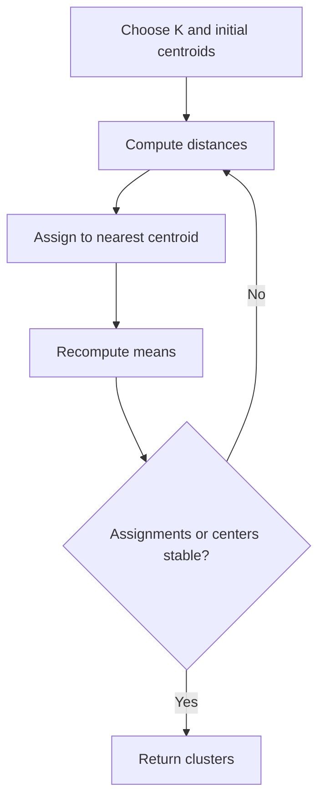

# AI Unit 3 - Exam-Ready Notes

**Subject:** Artificial Intelligence - Unsupervised Learning  
**Source:** *Ai Unit 3.pdf*, 126 PDF pages, Dr. Rajani S.  
**Format:** Seven sections: five theory sections followed by the two EL sections.

The notes cover every substantive topic, named technique, application and worked dataset in the PDF. Repeated title/closing slides are omitted. Numerical results are checked, and important slide errors or simplifications are identified. Page references below are PDF page numbers.

| Section | Topics | Source pages |
|---|---|---|
| 1 | Unsupervised learning: meaning, types, applications, benefits, challenges and supervised comparison | 3-16 |
| 2 | K-Means: algorithm, distances, centroids, convergence, new points, 1D marks and 2D customer examples | 20-34, 105-116 |
| 3 | Dimensionality reduction and PCA: selection/extraction, components, projection, examples, strengths and limitations | 38-55, 60-62 |
| 4 | Association rule mining: itemsets, support, confidence, lift, interpretation and applications | 66-74 |
| 5 | Apriori: candidate generation, pruning, thresholds, complete supermarket example and rule evaluation | 78-101 |
| 6 - EL | PCA: the eight-customer, three-feature projection exercise, reduced table and graphing | 56-59 |
| 7 - EL | Apriori: the online-shopping exercise and all requested answers | 120-125 |

**Study order:** Learn definitions and formulas, practise the worked tables, then attempt `questions.md`. Use `cheat-sheet.md` for final revision. Distances and projections are displayed to two decimal places; compare thresholds using unrounded values.

## 1. Unsupervised Learning

### 1.1 Definition and objective

**Unsupervised learning** is a machine-learning approach that discovers patterns, relationships or structure in data without predefined target labels. The input contains features, but not the correct output class/value for each record.

Its goal may be to group similar records, represent data with fewer features, discover items that occur together, or identify unusual patterns. It is useful for **exploratory data analysis (EDA)**: understanding a dataset before choosing later models or decisions.

**Example:** A mall supplies age, income and annual spending. An algorithm groups similar customers. An analyst may later describe the groups as premium, regular and budget customers. Those descriptions are interpretations, not labels the algorithm was given beforehand.

**Clarification:** “Without human intervention” in the slides means without supplying target answers during learning. People still choose data, features, algorithms, parameters and how to interpret the output.

### 1.2 Characteristics

- Works with unlabeled datasets and does not require a predefined target variable.
- Finds hidden patterns, similarities, relationships or group structure.
- Can automatically group similar examples.
- Supports exploration and can reduce data complexity.
- Produces results whose usefulness must be interpreted and evaluated carefully.

Unlabeled does not mean featureless or meaningless: age, marks and income are known features even when group membership is unknown.

### 1.3 Three main types

| Type | Main question | Output | Techniques named in the PDF |
|---|---|---|---|
| Clustering | Which records are similar? | Groups of records | K-Means; hierarchical clustering and DBSCAN are also named |
| Dimensionality reduction | Can fewer features represent the important structure? | Lower-dimensional representation | PCA |
| Association rule learning/mining | Which items tend to occur together? | Frequent itemsets and rules | Apriori; FP-Growth is named as a faster alternative |

**Clustering** groups observations; **dimensionality reduction** changes their representation; **association mining** discovers co-occurrence relationships. These outputs are different.

The comparison slide also names hierarchical clustering and DBSCAN as unsupervised examples, but does not teach their procedures. FP-Growth is mentioned as an alternative to Apriori; its internal algorithm is outside the supplied slides.

### 1.4 Examples from the slides

| Example | Input | Discovered structure / interpretation |
|---|---|---|
| Customer segmentation | Age, income, annual spending | Premium, regular or budget groups |
| Student performance | Attendance, internal marks, assignment scores | Higher-, middle- and lower-performing groups |
| News article grouping | Article content represented as features | Topic groups interpreted as sports, politics, business or technology |

An algorithm does not inherently know human topic names such as “Sports.” A person or an additional interpretation step supplies those meanings after inspecting the groups.

### 1.5 Applications

| Application | How unsupervised learning helps |
|---|---|
| Customer segmentation and market analysis | Find groups with similar buying behaviour |
| Market basket analysis | Find frequently co-purchased items |
| Recommendation systems | Suggest items using discovered associations or similarity |
| Fraud/anomaly detection | Flag unusual behaviour for further examination |
| Social network analysis | Explore communities and relationships |
| Medical image analysis | Explore patterns or group similar image features |
| Gene analysis / grouping | Find patterns in high-dimensional gene characteristics |
| Document clustering | Organize similar documents or articles |
| Image compression | Use a compact representation of visual information |

**Interpretation caution:** An unusual point is not automatically fraud, and an image cluster is not automatically a disease diagnosis. The unsupervised result is a pattern requiring suitable validation. “Gene classification” in the slides can refer to grouping genes by features; prediction of predefined gene labels would be supervised classification.

### 1.6 Advantages and challenges

| Advantages | Challenges |
|---|---|
| Avoids the time/cost of preparing target labels | There may be no ground-truth answer for easy accuracy measurement |
| Can reveal previously unknown structure | Clusters may not be meaningful for the intended task |
| Useful for EDA and large amounts of unlabeled data | Interpretation requires domain knowledge |
| Can simplify representations | Results depend on feature choice, scaling, algorithm and parameters |

**Feature choice:** Missing a useful feature can hide a genuine distinction. Including irrelevant features can distort similarity.

**Scaling:** If income is measured in rupees while another feature ranges from 0 to 100, income differences may dominate a distance calculation simply because of units. Consider scaling when feature magnitudes are not directly comparable. Scaling is a modelling decision, not proof that every feature should always have equal importance.

### 1.7 Supervised versus unsupervised learning

| Aspect | Supervised | Unsupervised |
|---|---|---|
| Training data | Inputs plus known target outputs | Inputs without target labels |
| Learning objective | Learn an input-to-target relationship | Discover structure or relationships |
| Typical tasks | Classification and regression | Clustering, association mining, dimensionality reduction |
| Training guidance | Correct target answers are provided | No target answer for each record is provided |
| Examples | Spam detection, disease prediction, house-price prediction | Customer segmentation, basket analysis, article grouping |
| Named algorithms | Decision tree, KNN, SVM, linear regression | K-Means, hierarchical clustering, DBSCAN, Apriori, PCA |
| Evaluation | Compare predictions with known targets | Evaluate structure, stability and usefulness; labels may be unavailable |
| Main cost issue | Label collection can be expensive | Interpretation and validation can be difficult |

The slide's suggestion that supervised learning generally has higher prediction accuracy is not a universal ranking: these approaches often solve different tasks. For a defined prediction task, useful labels can guide learning; an unlabeled exploratory task may have no comparable prediction-accuracy score.

**Exam answer:** Definition → absence of target labels → three types with examples → benefits → feature/scaling/evaluation limitations.

## 2. K-Means Clustering

### 2.1 Meaning and key terms

**K-Means** is a centroid-based unsupervised clustering algorithm that partitions observations into K groups by repeatedly assigning each point to its nearest centroid and recomputing cluster means.

- **K:** Chosen number of clusters.
- **Mean/centroid:** The coordinate-wise arithmetic average of the points assigned to a cluster.
- **Assignment:** Choose the closest centroid for each point.
- **Iteration:** An assignment step followed by a centroid-update step.
- **Convergence:** The assignments/centroids become stable under the stopping criterion.

Cluster numbers are arbitrary identifiers. Cluster 1 is not inherently “best” or “highest.” A centroid need not be one of the original observations.

### 2.2 Algorithm

1. Choose K.
2. Select K initial centroids; the slides randomly choose existing observations.
3. Compute each observation's Euclidean distance to every centroid.
4. Assign each observation to the nearest centroid.
5. Recompute each centroid as the mean of its assigned observations.
6. Repeat steps 3-5 until assignments or centroids stop changing.

Once the initial centroids are fixed, ordinary distance and mean calculations are not random. Random initialization can cause different runs to settle at different solutions.



### 2.3 Formulas

For one feature:

$$d(x,c)=\sqrt{(x-c)^2}=|x-c|.$$

For two features:

$$d((x,y),(a,b))=\sqrt{(x-a)^2+(y-b)^2}.$$

For a cluster with n observations:

$$\mu_x=\frac{\sum_{i=1}^{n}x_i}{n},\qquad
\mu_y=\frac{\sum_{i=1}^{n}y_i}{n}.$$

For understanding the objective, K-Means seeks a small **within-cluster sum of squared distances**:

$$J=\sum_{j=1}^{K}\sum_{x_i\in C_j}\|x_i-\mu_j\|^2.$$

The arithmetic mean minimizes this squared-distance sum for a fixed cluster. Stable convergence does not prove that the global best clustering has been found. For a distance tie, apply a stated consistent tie-breaking rule; do not silently invent a unique nearest cluster.

### 2.4 Worked example 1: student marks, K = 3

**Source:** PDF pages 22-30. We use **H, M, L** for high-, middle- and low-mark groups to avoid the slides' changing numerical cluster labels.

Initial centroids: **H = 92, M = 55, L = 22**.

| Student | Marks | Distance to H = 92 | Distance to M = 55 | Distance to L = 22 | Assignment |
|---|---:|---:|---:|---:|---|
| A | 92 | 0 | 37 | 70 | H |
| B | 89 | 3 | 34 | 67 | H |
| C | 85 | 7 | 30 | 63 | H |
| D | 58 | 34 | 3 | 36 | M |
| E | 55 | 37 | 0 | 33 | M |
| F | 52 | 40 | 3 | 30 | M |
| G | 18 | 74 | 37 | 4 | L |
| H | 22 | 70 | 33 | 0 | L |
| I | 25 | 67 | 30 | 3 | L |

The letter H in the Student column is a student ID; H in the Assignment column names the high-mark group.

**Recompute centroids:**

| Group | Members | Calculation | New centroid |
|---|---|---|---:|
| High | A, B, C | `(92 + 89 + 85) / 3 = 266/3` | 88.67 |
| Middle | D, E, F | `(58 + 55 + 52) / 3 = 165/3` | 55.00 |
| Low | G, H, I | `(18 + 22 + 25) / 3 = 65/3` | 21.67 |

**Reassign using the new centroids:**

| Student | Marks | Distance to High | Distance to Middle | Distance to Low | Assignment |
|---|---:|---:|---:|---:|---|
| A | 92 | 3.33 | 37.00 | 70.33 | High |
| B | 89 | 0.33 | 34.00 | 67.33 | High |
| C | 85 | 3.67 | 30.00 | 63.33 | High |
| D | 58 | 30.67 | 3.00 | 36.33 | Middle |
| E | 55 | 33.67 | 0.00 | 33.33 | Middle |
| F | 52 | 36.67 | 3.00 | 30.33 | Middle |
| G | 18 | 70.67 | 37.00 | 3.67 | Low |
| H | 22 | 66.67 | 33.00 | 0.33 | Low |
| I | 25 | 63.67 | 30.00 | 3.33 | Low |

Memberships are unchanged; recomputing means gives the same centroids. Therefore this run has converged.

**Slide-label correction:** Earlier slides call the high group C1 and the low group C3; later slides reverse those IDs. The memberships and centroid values are unchanged. State your naming convention and use it consistently.

### 2.5 Assigning a new point versus updating the model

For a new student with marks **60**, distances to low, middle and high centroids are **38.33, 5.00 and 28.67**. Assign the student to the **middle group**.

This is assignment using existing centroids, not supervised classification against a known correct label. It does not automatically retrain or update the centroids. If 60 were included in a recomputed middle-group mean, that mean would become `(58 + 55 + 52 + 60) / 4 = 56.25`.

The slides suggest assigning a few new records to existing clusters and refitting when many new records arrive or the distribution changes. This is a practical guideline, not a universal “one or two records” rule; model updates depend on the intended use and data changes.

### 2.6 Worked example 2: customer income and spending, K = 2

**Source:** PDF pages 105-116. Feature 1 is income in thousands of rupees; feature 2 is a spending score from 0 to 100.

| Customer | Income | Spending score |
|---|---:|---:|
| C1 | 20 | 25 |
| C2 | 22 | 30 |
| C3 | 25 | 28 |
| C4 | 60 | 65 |
| C5 | 62 | 68 |
| C6 | 65 | 70 |

Initial centroids: **A = (20,25)** from C1; **B = (60,65)** from C4.

For C2:

$$d(C2,A)=\sqrt{(22-20)^2+(30-25)^2}=\sqrt{29}\approx5.39,$$
$$d(C2,B)=\sqrt{(22-60)^2+(30-65)^2}=\sqrt{2669}\approx51.66.$$

Therefore C2 joins A. Repeat for all customers:

| Customer | Distance to A | Distance to B | Assignment |
|---|---:|---:|---|
| C1 | 0.00 | 56.57 | A |
| C2 | 5.39 | 51.66 | A |
| C3 | 5.83 | 50.93 | A |
| C4 | 56.57 | 0.00 | B |
| C5 | 60.11 | 3.61 | B |
| C6 | 63.64 | 7.07 | B |

**Update:**

$$A=\left(\frac{20+22+25}{3},\frac{25+30+28}{3}\right)
=\left(\frac{67}{3},\frac{83}{3}\right)\approx(22.33,27.67).$$

$$B=\left(\frac{60+62+65}{3},\frac{65+68+70}{3}\right)
=\left(\frac{187}{3},\frac{203}{3}\right)\approx(62.33,67.67).$$

**Check the next iteration:**

| Customer | Distance to new A | Distance to new B | Assignment |
|---|---:|---:|---|
| C1 | 3.54 | 60.10 | A |
| C2 | 2.36 | 55.19 | A |
| C3 | 2.69 | 54.47 | A |
| C4 | 53.03 | 3.54 | B |
| C5 | 56.57 | 0.47 | B |
| C6 | 60.10 | 3.54 | B |

Assignments are unchanged, so these means remain the final centroids. Interpretation: A contains lower-income/lower-spending customers; B contains higher-income/higher-spending customers **within this dataset**.

**Graph:** Plot income horizontally and spending score vertically; label the six exact coordinates. Mark initial and final centroids separately. The source plot has a customer-label typo near `(60,65)`; that point is **C4**. The C3-to-initial-B distance is approximately **50.93**, correcting the slide's 50.91.

### 2.7 Advantages, limitations and applications

| Advantages | Limitations |
|---|---|
| Simple and easy to implement | K must be chosen in advance |
| Often fast and efficient on large datasets | Sensitive to initial centroids; different local solutions are possible |
| Often converges quickly | Outliers can pull arithmetic means away from typical points |
| Suits compact, approximately spherical clusters | Can perform poorly on irregular shapes or clusters with very different sizes/spreads |

Feature scaling affects Euclidean distance and therefore the result. A well-separated scatter plot does not remove the need to compute/justify assignments in a numerical answer.

**Applications:** Customer segmentation, market segmentation, image compression by grouping similar pixel colours, anomaly exploration and document clustering.

**Exam calculation checklist:** State K and starting centers → distance table → assignments → coordinate-wise means → repeat → show stability → interpret groups. Use full precision internally and round displayed results at the end.

## 3. Dimensionality Reduction and PCA

### 3.1 Dimensionality reduction: meaning and purpose

**Dimensionality reduction** reduces the number of input features while trying to preserve the information useful for the task. A dataset with many features can be difficult to visualize, expensive to process and redundant.

Benefits can include lower computation/memory needs, simpler visualization, less redundancy and reduced noise or overfitting. These are possible benefits, not guarantees: removing a feature/component can also remove useful information.

**Rows versus columns:** If 100 records with 10 features become 100 records with 2 components, the number of observations is unchanged. It is the feature dimension that decreases.

### 3.2 Feature selection versus feature extraction

| Aspect | Feature selection | Feature extraction |
|---|---|---|
| Action | Retain a subset of original features | Transform original features into new features |
| Original feature meaning | Retained columns keep their meaning | New features may combine several meanings |
| New variables created? | No | Yes |
| Example | Keep Income and Savings; remove a redundant Salary column | Create `PC1 = a × Income + b × Salary + ...` |

The slides list **PCA, LDA, t-SNE, UMAP and autoencoders** as feature-extraction techniques. This is a general dimensionality-reduction list: **LDA is normally supervised** and uses class information. Not every dimensionality-reduction technique is unsupervised merely because it appears in this unit. PCA is the technique developed in detail here.

### 3.3 Applications and numerical illustrations

| Application | Original representation | Reduced representation / purpose |
|---|---|---|
| Image compression | A 100 × 100 grayscale image gives 10,000 pixel features; 8-bit values are 0-255 | Example: 500 learned features, potentially enabling compact reconstruction and faster processing |
| Face recognition | 64 × 64 pixels = 4,096 features | Example: 100 features used by a recognition system |
| Text mining/NLP | Document-term representation with 20,000 vocabulary features | Example: 300 representation features for downstream language tasks |
| Bioinformatics/genomics | Thousands of gene-expression features | Fewer informative components for analysis |
| Visualization | Three or more dimensions | Two/three components for plotting, or one for a simple reduction |
| Finance | Correlated financial indicators | A smaller number of factors |
| ML preprocessing | Many redundant features | Smaller model input |

The text-mining graphic names **LSA, PCA and word embeddings**, with downstream uses including document classification, spam detection, sentiment analysis, topic modelling and search improvement. Reducing a representation does not make every downstream task unsupervised.

**Dimension-count calculations:** 10,000 → 500 is a **95% feature-count reduction**; 20,000 → 300 is a **98.5% reduction**. These percentages are not the percentage of information/variance retained. Image quality and model accuracy must be checked; storing the learned transformation also has a cost.

### 3.4 PCA: definition and working idea

**Principal Component Analysis (PCA)** is an unsupervised, linear dimensionality-reduction technique that transforms data to new axes chosen to preserve as much variance as possible in the retained components.

It re-expresses observations using **principal components (PCs)**, which are weighted combinations of the original features. Correlated features can often be represented efficiently by fewer components.

| Component | Meaning |
|---|---|
| PC1 | Direction with maximum data variance |
| PC2 | Direction with maximum remaining variance, constrained to be orthogonal to PC1 |
| PC3 and later | Further orthogonal directions, ordered by remaining variance |

**Orthogonal** means perpendicular. PCA component scores are uncorrelated on the data used to fit the usual covariance-based PCA. **Uncorrelated does not generally mean statistically independent**, despite the slide's wording.

Variance measures spread; it is not the same thing as predictive usefulness for a particular target. PCA does not use target labels to decide which direction matters.

### 3.5 Formula and conceptual calculation procedure

For two appropriately prepared features:

$$PC1=aX+bY.$$

Here a and b are the component's weights or loadings. The weights depend on the dataset; they are not universally equal or chosen merely by averaging feature names.

For standard centered PCA, a more explicit score formula is:

$$z_1=a(x-\bar{x})+b(y-\bar{y}).$$

Conceptual steps:

1. Prepare the feature matrix and check units/scales.
2. Center features by subtracting their means; standardize if appropriate for their scales.
3. Compute the covariance matrix of the prepared data.
4. Find its eigenvectors and eigenvalues: directions and their associated variances.
5. Order directions by decreasing eigenvalue.
6. Retain the desired leading components and project every observation onto them.

Covariance-based eigenvector calculations and singular value decomposition are equivalent routes to ordinary PCA. The PDF mentions covariance matrices/eigenvectors but does not require a full eigenvalue derivation in its worked exercises.

**Centering versus scaling:** Subtracting the mean does not put different units on the same scale. Standardization also divides by a suitable standard deviation. For example, the scikit-learn PCA implementation centers inputs but does not automatically standardize each input feature.

### 3.6 Correlated-feature examples

**Income and Salary:** These may contain overlapping information. PCA can combine them with Age, Savings and Loan information into fewer axes; it does not simply delete Salary by name.

**Math and Physics:** The slides give:

| Student | Math | Physics | Simple average, for intuition only |
|---|---:|---:|---:|
| A | 90 | 92 | 91.0 |
| B | 80 | 82 | 81.0 |
| C | 70 | 71 | 70.5 |
| D | 60 | 58 | 59.0 |

Both scores generally increase together, so a combined “Science Skill” direction illustrates redundancy. This is an analogy, not a derivation of exact PCA scores. The slide lists 70 for C; a literal mean of 70 and 71 is **70.5**. Correlation here means the columns move together; neither column necessarily has a small individual variance.

### 3.7 Worked 2D-to-1D projection from the slides

The supplied points are `(2,3)`, `(3,4)`, `(5,7)` and `(6,8)`. The slide gives the illustrative formula:

$$PC1=\frac{x+y}{\sqrt{2}}.$$

Apply that given formula:

| Point | x | y | Sum | Given PC1 score |
|---|---:|---:|---:|---:|
| P1 | 2 | 3 | 5 | 3.54 |
| P2 | 3 | 4 | 7 | 4.95 |
| P3 | 5 | 7 | 12 | 8.49 |
| P4 | 6 | 8 | 14 | 9.90 |

For example, `(2+3)/sqrt(2) = 3.5355... ≈ 3.54`. Four observations with two features become four observations with one score each.

**Projection interpretation:** A point is represented by its position along one chosen direction; distinctions perpendicular to that direction are discarded. Two different points can therefore have the same reduced score.

**Important distinction for exams:** These positive scores follow the slide's supplied **uncentered equal-weight projection**. They are not the scores obtained by independently fitting standard centered PCA to these four points. Use a given formula exactly when that is the question. If asked to perform full PCA, center/prepare the data and derive the directions instead. Do not silently mix the two procedures.

### 3.8 Advantages, limitations and exam traps

| Advantages | Limitations |
|---|---|
| Reduces computational cost | Combined features can be difficult to interpret |
| Helps visualize high-dimensional data | Ordinary PCA represents linear directions |
| Reduces redundancy in correlated features | Sensitive to feature scales |
| Can remove noise and reduce overfitting | Removing too many components may lose useful information |

- PC1 is a new weighted feature, not necessarily an original column.
- Orthogonal component directions do not imply full statistical independence.
- Maximum variance is not automatically maximum classification accuracy.
- Reducing three dimensions to one does not prove that exactly two-thirds of the information was lost.
- The sign of a PCA direction can be reversed with all its scores; the represented axis is unchanged.
- Retaining more components generally preserves more variance, at the cost of more dimensions.

**Exam answer:** Define PCA → explain PC1/PC2 and orthogonality → distinguish selection from extraction → show a weighted projection → discuss scaling, interpretability and information loss.

## 4. Association Rule Mining

### 4.1 Meaning and purpose

**Association rule mining** discovers relationships between items that occur together in a transaction dataset. In market basket analysis, it asks which products customers tend to buy together.

Examples in the slides include Bread with Butter, Chips with Soft Drinks, Shampoo with Conditioner and Laptop with Laptop Bag. Businesses can use such patterns for cross-selling, promotions and recommendations.

A rule has the form **X → Y**:

- **X:** Antecedent, or the itemset on the left.
- **Y:** Consequent, or the itemset on the right.
- Interpretation: Transactions containing X also tend to contain Y.

X and Y are nonempty itemsets with no item in common. A rule describes an association, not a guaranteed outcome, purchase order or causal effect.

### 4.2 Basic terminology

| Term | Meaning | Example |
|---|---|---|
| Transaction | One basket/record containing items | `{Milk, Bread, Butter}` |
| Itemset | A set of one or more items | `{Milk, Bread}` |
| 1-, 2-, 3-itemset | Itemset containing one, two or three distinct items | `{Milk}`, `{Milk, Bread}`, `{Milk, Bread, Butter}` |
| Support count | Number of transactions containing every item in an itemset | Count of baskets containing both Milk and Bread |
| Frequent itemset | Itemset meeting the minimum support | Support at least 40%, if that threshold is given |

When `X ∪ Y` appears in a rule formula, it is the **combined itemset**: a transaction must contain all items from X and Y. It does not mean “contains either one” for the support count.

### 4.3 Support, confidence and lift

Let N be the total number of transactions and n(X) the number containing X.

$$\operatorname{support}(X)=\frac{n(X)}{N}.$$

$$\operatorname{support}(X\to Y)=\operatorname{support}(X\cup Y)
=\frac{n(X\cup Y)}{N}.$$

$$\operatorname{confidence}(X\to Y)
=\frac{n(X\cup Y)}{n(X)}
=\frac{\operatorname{support}(X\cup Y)}{\operatorname{support}(X)}.$$

$$\operatorname{lift}(X\to Y)
=\frac{\operatorname{confidence}(X\to Y)}{\operatorname{support}(Y)}
=\frac{\operatorname{support}(X\cup Y)}
{\operatorname{support}(X)\operatorname{support}(Y)}.$$

Use nonzero denominators. Multiply a proportion by 100 to express support/confidence as a percentage. Lift is a ratio, not a percentage. Use consistent units: `0.75/0.80` or `75%/80%`, not `75/0.80`.

| Measure | Question answered | Key property |
|---|---|---|
| Support | How common is the combined itemset in all transactions? | Same for X → Y and Y → X |
| Confidence | Among transactions with X, how many also contain Y? | Direction-dependent in general |
| Lift | Is Y more common with X than it is overall? | Same for the two reversed directions of a fixed itemset pair |

### 4.4 Lift interpretation

| Lift | Interpretation in the observed data |
|---|---|
| Greater than 1 | Positive association; Y is more frequent conditional on X than overall |
| Equal to 1 | Co-occurrence matches the independence baseline |
| Less than 1 | Negative association relative to that baseline |

High support indicates coverage; high confidence indicates a high conditional frequency; lift adds the baseline comparison. A common consequent can create high confidence even without a positive association.

Do not interpret lift above 1 as proof that buying X causes someone to buy Y. It measures a relationship in the dataset, not a causal experiment.

### 4.5 Introductory example: use the correct transaction table

**Source:** PDF page 70. This is different from the later Apriori supermarket table.

| Transaction | Items |
|---|---|
| T1 | Milk, Bread |
| T2 | Milk, Bread, Butter |
| T3 | Bread, Butter |
| T4 | Milk, Bread, Butter |
| T5 | Milk, Butter |

Milk, Bread and Butter each occur **4** times. Each pair occurs **3** times. The triple occurs **2** times.

For Milk → Bread:

- Support = `3/5 = 60%`.
- Confidence = `3/4 = 75%`.
- Bread's support = `4/5 = 80%`.
- Lift = `0.75/0.80 = 0.9375`, so the relationship is slightly negative relative to Bread's baseline frequency.

Thus a 75% confidence rule can still have lift below 1. The separate support illustration in the slides correctly describes 4 out of 5 as 80%, but prints the fraction backwards once: **4/5**, not 5/4.

### 4.6 Applications, advantages and limitations

**Applications:** Retail/e-commerce basket analysis; product/content recommendations; exploratory healthcare relationships such as symptom co-occurrences. The slides mention Amazon and Netflix as recommendation examples, not as proof that either service uses only association rules.

**Advantages:** Reveals non-obvious item relationships; supports decisions and recommendations; requires no predefined class labels.

**Limitations:** Many candidate combinations and rules can be generated; many rules are unhelpful; support/confidence thresholds require selection; processing can become expensive as transactions/items increase. Filter rules using relevant metrics and domain usefulness.

**Exam answer:** Define transaction/itemset/rule → write the three formulas with correct denominators → calculate → interpret support, confidence and lift separately → avoid causal claims.

## 5. Apriori Algorithm

### 5.1 Definition and principle

**Apriori** is an association-mining algorithm that finds frequent itemsets and then generates association rules from them. It is commonly used for market basket analysis.

Its key principle is:

> If an itemset is infrequent, every superset containing it is also infrequent.

Equivalently, **every subset of a frequent itemset must also be frequent**. A larger itemset cannot occur in more transactions than any one of its subsets, because every transaction containing the larger set contains all its subsets.

**Pruning** eliminates candidates that cannot possibly meet minimum support. This principle concerns support; do not assume confidence follows the same monotonic rule.

**Important one-way implication:** All pairs in a triple being frequent does not guarantee the triple is frequent. It only means the triple has not yet been ruled out by that subset test.

### 5.2 Steps and notation

- **Ck:** Candidate itemsets of size k.
- **Lk:** Frequent itemsets of size k, after support filtering.

Procedure:

1. Count each individual item to obtain candidate 1-itemsets C1.
2. Keep those meeting minimum support to form L1.
3. Join compatible frequent itemsets to form larger candidates.
4. Prune a candidate if any required smaller subset is infrequent.
5. Count remaining candidates in the transaction database.
6. Keep frequent candidates as the next Lk; repeat until no larger frequent itemsets remain.
7. Split frequent itemsets into nonempty antecedent/consequent parts.
8. Compute confidence and retain rules meeting the specified confidence threshold; evaluate lift/usefulness if required.

### 5.3 Threshold arithmetic

If the minimum support proportion is s and there are N transactions:

$$\text{minimum support count}=\lceil sN\rceil.$$

The ceiling is necessary because counts are integers. For 5 transactions at 40%, `ceil(0.40 × 5) = 2`. For 6 transactions at 40%, the minimum is **3**, not 2.

“Minimum support 40%” means **support ≥ 40%**, including equality. Several slides print `> 0.4` while retaining 0.4 itemsets; the intended and consistent condition is **≥ 0.4**.

Minimum confidence is likewise inclusive. Compare unrounded fractions first, then display percentages rounded to two decimal places.

### 5.4 Worked supermarket dataset

**Source:** PDF pages 82-99. **Do not substitute the introductory table from Section 4.**

| Transaction | Items purchased |
|---|---|
| T1 | Milk, Bread, Butter |
| T2 | Bread, Butter, Jam |
| T3 | Milk, Bread |
| T4 | Milk, Butter |
| T5 | Bread, Butter |

N = 5; minimum support = 40%; minimum support count = 2.

### 5.5 Step 1: frequent 1-itemsets

| Item | Transactions | Count | Support | Frequent? |
|---|---|---:|---:|---|
| Milk | T1, T3, T4 | 3 | 60% | Yes |
| Bread | T1, T2, T3, T5 | 4 | 80% | Yes |
| Butter | T1, T2, T4, T5 | 4 | 80% | Yes |
| Jam | T2 | 1 | 20% | No |

**L1 = {{Milk}, {Bread}, {Butter}}.** Jam is infrequent, so any pair/triple containing Jam can be pruned.

### 5.6 Step 2: frequent 2-itemsets

Generate pairs from the frequent individual items:

| Pair | Transactions | Count | Support | Frequent? |
|---|---|---:|---:|---|
| {Milk, Bread} | T1, T3 | 2 | 40% | Yes |
| {Milk, Butter} | T1, T4 | 2 | 40% | Yes |
| {Bread, Butter} | T1, T2, T5 | 3 | 60% | Yes |

**L2 = {{Milk, Bread}, {Milk, Butter}, {Bread, Butter}}.** The two 40% pairs qualify exactly at the threshold.

### 5.7 Step 3: test the 3-itemset

All three pairs are frequent, so `{Milk, Bread, Butter}` is a valid candidate to count.

It appears only in T1:

$$\operatorname{support}(\{Milk,Bread,Butter\})=\frac{1}{5}=20\%<40\%.$$

Therefore **L3 is empty**, and there is no frequent triple or larger itemset. This demonstrates that frequent subsets are necessary but not sufficient for a frequent superset.

### 5.8 Step 4: generate and evaluate rules

From each frequent pair, generate two directions. For example:

$$\operatorname{confidence}(Milk\to Bread)=\frac{2}{3}\approx66.67\%,$$
$$\operatorname{confidence}(Bread\to Milk)=\frac{2}{4}=50\%.$$

| Rule | Support | Confidence | Lift |
|---|---:|---:|---:|
| Milk → Bread | 40% | 66.67% | 0.8333 |
| Bread → Milk | 40% | 50.00% | 0.8333 |
| Milk → Butter | 40% | 66.67% | 0.8333 |
| Butter → Milk | 40% | 50.00% | 0.8333 |
| Bread → Butter | 60% | 75.00% | 0.9375 |
| Butter → Bread | 60% | 75.00% | 0.9375 |

The core supermarket example does not specify a minimum confidence. The table therefore lists the rule values without inventing a cutoff. **If** a separate question specifies 60% minimum confidence, four directions qualify: Milk → Bread, Milk → Butter, Bread → Butter and Butter → Bread.

### 5.9 Why the “best rule” still needs qualification

The slides call Bread → Butter the best rule because its support is 60% and confidence is 75%. Butter → Bread ties on those two metrics.

However, Butter already occurs in 80% of all transactions:

$$\operatorname{lift}(Bread\to Butter)=\frac{0.75}{0.80}=0.9375<1.$$

Buying Butter is slightly **less** common among bread-containing transactions than in the dataset overall. Thus this is a relatively high-support/high-confidence rule within the listed rules, but not a positive-lift association. “Best” must be tied to a stated metric or business goal.

**Confidence asks:** How often does Butter occur when Bread occurs?  
**Lift asks:** Is that rate higher than Butter's overall rate?

### 5.10 Advantages, limitations and common errors

**Advantages:** Simple and intuitive; useful for basket analysis; can expose useful relationships; support-based pruning avoids considering every possible combination without restrictions.

**Limitations:** Large candidate spaces and repeated counting can be slow; support/confidence thresholds must be chosen; many rules may still require filtering. The PDF names FP-Growth as an alternative.

**Avoid these errors:**

- Dividing by the number of items instead of the number of transactions for support.
- Using the consequent's count as the confidence denominator.
- Treating 40% minimum support as strictly more than 40%.
- Counting a transaction that contains only one item of a required pair.
- Assuming that frequent pairs force a frequent triple.
- Assuming that high confidence proves positive lift or causation.
- Mixing counts from different transaction tables.

## 6. EL - PCA Projection of Customer Data

### 6.1 Given data and tasks

**Source:** PDF pages 56-59. Each customer has three monetary features, in thousands of rupees.

| Customer | Income X1 | Spending X2 | Savings X3 |
|---|---:|---:|---:|
| C1 | 30 | 20 | 10 |
| C2 | 35 | 25 | 12 |
| C3 | 40 | 30 | 15 |
| C4 | 45 | 35 | 18 |
| C5 | 50 | 40 | 20 |
| C6 | 55 | 45 | 22 |
| C7 | 60 | 50 | 25 |
| C8 | 65 | 55 | 28 |

The exercise asks you to draw the original data, calculate PC1 using the supplied formula, write the reduced table and draw the reduced data.

**Given formula:**

$$PC1=\frac{X1+X2+X3}{\sqrt{3}}.$$

Use the raw values as instructed. The weights are `(1/sqrt(3), 1/sqrt(3), 1/sqrt(3))`, approximately `(0.57735, 0.57735, 0.57735)`. Their squared sum is 1, so this is a unit direction. Dividing by `sqrt(3)` is not the same as taking the arithmetic mean, which would divide by 3.

### 6.2 Complete calculation and reduced table

For C1:

$$PC1=\frac{30+20+10}{\sqrt{3}}=\frac{60}{\sqrt{3}}\approx34.64.$$

| Customer | Calculation | Sum of features | Reduced PC1 value |
|---|---|---:|---:|
| C1 | `(30 + 20 + 10) / sqrt(3)` | 60 | 34.64 |
| C2 | `(35 + 25 + 12) / sqrt(3)` | 72 | 41.57 |
| C3 | `(40 + 30 + 15) / sqrt(3)` | 85 | 49.07 |
| C4 | `(45 + 35 + 18) / sqrt(3)` | 98 | 56.58 |
| C5 | `(50 + 40 + 20) / sqrt(3)` | 110 | 63.51 |
| C6 | `(55 + 45 + 22) / sqrt(3)` | 122 | 70.44 |
| C7 | `(60 + 50 + 25) / sqrt(3)` | 135 | 77.94 |
| C8 | `(65 + 55 + 28) / sqrt(3)` | 148 | 85.45 |

**Reduced dataset:** `[34.64, 41.57, 49.07, 56.58, 63.51, 70.44, 77.94, 85.45]`.

There are still **eight customers**, but each now has **one feature instead of three**. Feature dimension decreases by `(3-1)/3 × 100 ≈ 66.67%`. This does not determine the variance retained.

### 6.3 How to draw both requested graphs

[View the completed PCA EL graphs](https://chatgpt.com/library?file_id=libfile_e45c2e65526c8191b9c1e8bf23d22d6c&account_id=personal): the exact eight-customer dataset in 3D and its one-dimensional scores using the supplied formula.

**Original data:** Use a 3D scatter plot with Income on the x-axis, Spending on the y-axis and Savings on the z-axis. Plot all eight triples from the given table and label C1-C8. All three features tend to increase together. On paper, three pairwise plots can also show this structure, but a single 2D Income-versus-Spending plot alone omits Savings.

**Reduced data:** Draw a single horizontal PC1 axis and place C1-C8 at the eight calculated scores. If using a 2D plotting tool, place every point at vertical coordinate zero; that zero is only a display aid, not another learned feature. Do not use the original Income axis for the reduced scores.

This optional plotting program draws the exact exercise data and saves the graphs:

```python
from math import sqrt
import matplotlib.pyplot as plt

customers = [f"C{i}" for i in range(1, 9)]
income = [30, 35, 40, 45, 50, 55, 60, 65]
spending = [20, 25, 30, 35, 40, 45, 50, 55]
savings = [10, 12, 15, 18, 20, 22, 25, 28]
scores = [
    (x + y + z) / sqrt(3)
    for x, y, z in zip(income, spending, savings)
]

fig = plt.figure(figsize=(12, 5), layout="constrained")
original = fig.add_subplot(1, 2, 1, projection="3d")
original.scatter(income, spending, savings)
for label, x, y, z in zip(customers, income, spending, savings):
    original.text(x, y, z, label)
original.set_xlabel("Income (thousand rupees)")
original.set_ylabel("Spending (thousand rupees)")
original.set_zlabel("Savings (thousand rupees)")
original.set_title("Original: 3 features")

reduced = fig.add_subplot(1, 2, 2)
reduced.scatter(scores, [0] * len(scores))
for i, (label, score) in enumerate(zip(customers, scores)):
    reduced.annotate(
        f"{label}\n{score:.2f}", (score, 0),
        xytext=(0, 12 if i % 2 == 0 else -28),
        textcoords="offset points", ha="center",
    )
reduced.set_yticks([])
reduced.set_ylim(-1, 1)
reduced.set_xlabel("PC1 = (Income + Spending + Savings) / sqrt(3)")
reduced.set_title("Reduced: 1 feature, still 8 customers")
fig.savefig("pca-el-graphs.png", dpi=180)
plt.close(fig)
```

### 6.4 Interpretation, centering and limitations

This supplied equal-weight formula gives larger scores to customers with larger sums of the three features. It is a projection exercise; it does not establish that a high score is good or bad.

Different triples with the same sum get the same score. For example, `(35,25,12)` and `(40,20,12)` both sum to 72, so both map to 41.57. The reduction loses the distinction between their Income and Spending values.

**Do not silently fit a different PCA model.** Standard centered PCA learned from this dataset need not have equal weights. The exercise explicitly provides the formula; applying it is the required calculation. Its accompanying generic scatter diagrams are illustrations of projection, not plots of these eight exact customer triples.

If a question separately asks for the **centered version of this same fixed projection**, the feature means are `(47.5, 37.5, 18.75)`, and the score is:

$$z=\frac{(X1-47.5)+(X2-37.5)+(X3-18.75)}{\sqrt{3}}.$$

That subtracts the common score offset `103.75/sqrt(3) ≈ 59.90` from every raw projection. The centered scores average to zero and preserve the same pairwise score differences. Centering the given direction is still different from deriving a new PCA direction.

**EL answer checklist:** Original table → clearly labeled original graph → stated formula → one sample substitution → all eight reduced values → 1D reduced graph → explain 3-to-1 dimensions and retained eight observations.

## 7. EL - Apriori for Online Shopping

### 7.1 Question, dataset and thresholds

**Source:** PDF pages 120-125. Use minimum support **40%** and minimum confidence **60%**.

| Customer / transaction | Products purchased |
|---|---|
| C1 | Mobile, Phone Case |
| C2 | Mobile, Earphones |
| C3 | Mobile, Phone Case, Screen Guard |
| C4 | Laptop, Mouse |
| C5 | Laptop, Mouse, Keyboard |

There are five transactions, so minimum support count is `ceil(0.40 × 5) = 2`.

The exercise asks for frequent 1-, 2- and 3-itemsets; support of `{Mobile, Phone Case}`; the rule Mobile → Phone Case; its confidence; acceptance at the threshold; and one practical use.

### 7.2 Frequent 1-itemsets

| Item | Transactions | Count | Support | Frequent? |
|---|---|---:|---:|---|
| Mobile | C1, C2, C3 | 3 | 60% | Yes |
| Phone Case | C1, C3 | 2 | 40% | Yes |
| Earphones | C2 | 1 | 20% | No |
| Screen Guard | C3 | 1 | 20% | No |
| Laptop | C4, C5 | 2 | 40% | Yes |
| Mouse | C4, C5 | 2 | 40% | Yes |
| Keyboard | C5 | 1 | 20% | No |

**L1 = {{Mobile}, {Phone Case}, {Laptop}, {Mouse}}.** These are four separate 1-itemsets, not one frequent 4-itemset. Earphones, Screen Guard and Keyboard, and supersets containing them, can be pruned at this threshold.

### 7.3 Frequent 2-itemsets

Four frequent individual items produce six distinct candidate pairs:

| Candidate pair | Count | Support | Frequent? |
|---|---:|---:|---|
| {Mobile, Phone Case} | 2 | 40% | Yes |
| {Mobile, Laptop} | 0 | 0% | No |
| {Mobile, Mouse} | 0 | 0% | No |
| {Phone Case, Laptop} | 0 | 0% | No |
| {Phone Case, Mouse} | 0 | 0% | No |
| {Laptop, Mouse} | 2 | 40% | Yes |

**L2 = {{Mobile, Phone Case}, {Laptop, Mouse}}.** Pairs involving an infrequent single item do not need to be counted as surviving Apriori candidates.

### 7.4 Frequent 3-itemsets

**There are no frequent 3-itemsets: L3 = empty set.**

The only surviving pairs are disjoint: `{Mobile, Phone Case}` and `{Laptop, Mouse}`. No triple has every 2-item subset frequent, so no valid triple survives Apriori pruning.

The triples actually seen in individual baskets, `{Mobile, Phone Case, Screen Guard}` and `{Laptop, Mouse, Keyboard}`, each occur only once: support 20%, below 40%. Their Screen Guard/Keyboard singletons were already infrequent.

### 7.5 Support of {Mobile, Phone Case}

Both products appear together in C1 and C3:

$$\operatorname{support}(\{Mobile,Phone\ Case\})=\frac{2}{5}=0.40=40\%.$$

This qualifies **exactly at the minimum support**.

### 7.6 Generate the rule and calculate confidence

**Rule:** Mobile → Phone Case.

Meaning: Among the transactions containing a Mobile, a certain proportion also contain a Phone Case.

There are three Mobile transactions, and two also contain Phone Case:

$$\operatorname{confidence}(Mobile\to Phone\ Case)=\frac{2}{3}
\approx0.6667=66.67\%.$$

Since the exact value `2/3 ≥ 0.60`, the rule passes the minimum-confidence requirement. It also passes minimum support, so it is accepted under the exercise's two thresholds.

**Interpretation:** Two of the three Mobile-containing transactions in this dataset also include a Phone Case. This is not a promise about every future customer.

### 7.7 Practical use

When a customer adds a Mobile to the cart, the platform can suggest a compatible Phone Case as a cross-sell recommendation. The rule supplies evidence for considering that recommendation; compatibility, relevance and actual customer response still matter.

An exam-ready sentence is: **“Recommend a phone case with a mobile purchase because the rule has 40% support and 66.67% confidence, meeting the given 40% and 60% thresholds.”**

### 7.8 Extra revision: reverse rules and lift

The following extends the exercise using the unit's lift formula:

| Rule | Support | Confidence | Lift |
|---|---:|---:|---:|
| Mobile → Phone Case | 40% | 66.67% | 1.6667 |
| Phone Case → Mobile | 40% | 100.00% | 1.6667 |
| Laptop → Mouse | 40% | 100.00% | 2.5000 |
| Mouse → Laptop | 40% | 100.00% | 2.5000 |

For Mobile → Phone Case, lift is `(2/3)/(2/5) = 5/3 ≈ 1.67`. Phone Case is more common in Mobile-containing baskets than it is overall. Reverse confidence differs because its denominator is the Phone Case count, but lift is unchanged.

If another transaction is added, recalculate N and every affected count. A high confidence or lift cannot rescue a rule that fails a required minimum-support filter.

### 7.9 Full short-answer model

“With five transactions and 40% minimum support, the minimum count is two. Frequent 1-itemsets are {Mobile}, {Phone Case}, {Laptop} and {Mouse}. Frequent 2-itemsets are {Mobile, Phone Case} and {Laptop, Mouse}. No 3-itemset is frequent. The Mobile-Phone Case itemset has support 2/5 = 40%. The rule Mobile → Phone Case has confidence 2/3 = 66.67%, which meets the 60% minimum, so it is accepted. The platform can use it to recommend a compatible phone case when a mobile is added to the cart.”

### Corrections to remember across the unit

| Slide issue | Correct interpretation |
|---|---|
| Student cluster IDs switch between high-first and low-first | Cluster IDs are arbitrary; keep membership and centroids consistent |
| K-Means calculations described as random | Initialization can be random; distance and mean updates follow the algorithm |
| PCA components called independent | They are uncorrelated under standard PCA; independence is a stronger property |
| Equal-weight raw PC formulas shown as if universal | Use the given formula for that exercise; fitted PCA directions depend on centered/prepared data |
| Dimensionality reduction implies guaranteed accuracy/quality improvement | Benefits depend on the retained information and downstream task |
| Support of four out of five printed as 5/4 | Correct fraction: 4/5 = 80% |
| Minimum support displayed with a strict `>` | Minimum means `>=`; equality qualifies |
| A “Support (%)” cell contains 0.4 | 0.4 is a proportion; the percentage is 40% |
| Bread → Butter called uniquely best | Reverse direction ties on support/confidence; both have lift below 1 |
| Different supermarket tables appear in the PDF | Recount using the table attached to the specific question |

### Source and supporting references

The uploaded *Ai Unit 3.pdf* is the syllabus source. Numerical tables in these notes are calculated from its supplied datasets. Supplementary primary documentation supports the implementation/conceptual clarifications:

- [scikit-learn: PCA overview and centering](https://scikit-learn.org/stable/modules/decomposition.html#pca)
- [scikit-learn: PCA reference](https://scikit-learn.org/stable/modules/generated/sklearn.decomposition.PCA.html)
- [scikit-learn: K-Means reference, inertia and local minima](https://scikit-learn.org/stable/modules/generated/sklearn.cluster.KMeans.html)
