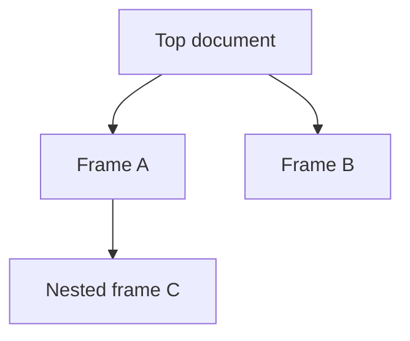

# STA Unit 4 — Exam-Ready Notes

**Subject:** UQ24CA342A — Software Testing and Automation  
**Source:** *STA Unit 4.pdf*, 146 PDF pages, Mrs. Sowmya BP.  
**Structure:** Five theory sections and two EL sections. Page numbers below refer to PDF pages.

These notes cover the concepts, HTML controls, Selenium operations, assertion methods and exercises in the slides. Repeated screenshots are consolidated into explanations. Examples use Selenium 4 Python syntax. Corrections to slide syntax and misleading statements are identified where they matter. Sections 6–7 provide suggested solutions to the two EL prompts; the PDF does not supply those solutions or test results.

| Section | Coverage | Source pages |
|---|---|---|
| 1 | Functional testing; default, submit and image buttons; button states; checkboxes | 1–49 |
| 2 | Labels; single and multiple selection lists; textboxes; textareas; alerts | 50–89 |
| 3 | IFrames; locating frames; entering and leaving frame contexts | 90–110 |
| 4 | Assertions; eight basic assertions; collection types; membership assertions; unittest lifecycle | 111–136 |
| 5 | Six comparison assertions; boundaries; counts and values | 137–144 |
| 6 — EL | Selenium automation of SauceDemo | 146, activity 1 |
| 7 — EL | Selenium automation of ParaBank | 146, activity 2 |

Page 145 is a closing slide. Use `questions.md` for 28 MCQs and `cheat-sheet.md` for rapid revision.

## 1. Functional Testing, Buttons and Checkboxes

### 1.1 Functional testing and Selenium

**Functional testing** checks whether an application's observable behaviour matches its requirements. For example, clicking Login with valid credentials should show the expected authenticated page; selecting a checkbox should change its checked state.

**Selenium WebDriver** controls a browser. It locates elements, performs user actions and reads resulting states. An **assertion** compares the actual result with the expected result. A script that clicks a button and prints “PASS” without checking an outcome has not established functional correctness.

Use this sequence in a practical answer:

1. Identify the requirement and expected result.
2. Open the page and establish the required initial state.
3. Locate the element in the correct document or frame.
4. Perform the action.
5. Wait for the relevant resulting state.
6. Assert that actual and expected results agree.
7. Close the browser and record the outcome.

### 1.2 Setup and common locator syntax

Install Selenium with `python -m pip install selenium`. A suitable browser must also be installed. A basic Selenium 4 setup is:

```python
from pathlib import Path
from selenium import webdriver
from selenium.webdriver.common.by import By
from selenium.webdriver.support.ui import WebDriverWait, Select
from selenium.webdriver.support import expected_conditions as EC

driver = webdriver.Chrome()
try:
    driver.get(Path("controls.html").resolve().as_uri())
    button = WebDriverWait(driver, 10).until(
        EC.element_to_be_clickable((By.ID, "default_btn"))
    )
    button.click()
finally:
    driver.quit()
```

`controls.html` must exist. `Path(...).resolve().as_uri()` creates a local file URL without hard-coding a Windows path. `driver.get()` opens the page; `driver.quit()` ends the browser session. An explicit wait repeatedly checks a condition until it succeeds or times out. `time.sleep()` always waits a fixed duration and does not check readiness.

The slides also use the external `webdriver-manager` package. If following that approach, initialize `options` before using it:

```python
from selenium.webdriver.chrome.options import Options
from selenium.webdriver.chrome.service import Service
from webdriver_manager.chrome import ChromeDriverManager

options = Options()
service = Service(ChromeDriverManager().install())
driver = webdriver.Chrome(service=service, options=options)
```

This alternative additionally requires `python -m pip install webdriver-manager`. Simply importing `Options` does not create the `options` variable. Do not execute several alternative examples in one session after the first has already called `quit()`.

| Purpose | Selenium 4 example |
|---|---|
| Unique ID | `driver.find_element(By.ID, "default_btn")` |
| Name attribute | `driver.find_element(By.NAME, "dft_btn")` |
| CSS selector | `driver.find_element(By.CSS_SELECTOR, "button.default")` |
| XPath expression | `driver.find_element(By.XPATH, "//button[@id='default_btn']")` |
| All matching elements | `driver.find_elements(By.TAG_NAME, "button")` |

**Singular versus plural:** `find_element()` returns the first matching `WebElement`; if none exists, it raises `NoSuchElementException`. `find_elements()` returns a list, possibly empty. A list has no Selenium `.click()` method. Use a specific singular locator or deliberately select/iterate over the list.

**Slide correction:** Replace old calls such as `find_element_by_id(...)` with `find_element(By.ID, ...)`. Also, `.click()` returns `None`; assigning its result does not retain the element:

```python
button = driver.find_element(By.ID, "default_btn")
button.click()
assert button.is_enabled()
```

### 1.3 Default or ordinary button

A `<button>` displays a caption between its opening and closing tags. Its application-defined action may create, edit, delete, reset or clear something.

```html
<button id="default_btn" class="default" name="dft_btn" type="button">
  Default Button
</button>
```

The slides describe two major operations: **select/locate and click**, and **assert its state**. Their term “select a button” means locating it, not using the Selenium `Select` class.

Equivalent locator examples, assuming each expression uniquely matches the intended button:

```python
driver.find_element(By.ID, "default_btn").click()
driver.find_element(By.NAME, "dft_btn").click()
driver.find_element(By.XPATH, "//button[text()='Default Button']").click()
driver.find_element(
    By.XPATH, "//button[normalize-space(.)='Default Button']"
).click()
driver.find_element(
    By.XPATH, "//button[contains(normalize-space(.), 'Default Button')]"
).click()
```

Treat these as alternatives, not as instructions to trigger the same action five times. Exact `text()` matching can fail when the text contains indentation, extra whitespace or nested elements. `normalize-space(.)` trims and collapses whitespace in the element's combined text. `contains(value, substring)` performs a partial match and can match more than one element, so use it carefully.

**Correct spellings and syntax:** `normalize-space`, not `normalize-pace`; `contains(text(), 'Default Button')`, not `contains(text()='Default Button')`.

**HTML distinction:** Inside a form, a `<button>` without an explicit `type` normally acts as a submit button. Use `type="button"` for an ordinary action, `type="submit"` to submit and `type="reset"` to restore form defaults. A reset restores initial values; it does not necessarily make every field empty.

### 1.4 Submit button

A submit control initiates form submission. The slides' example collects employee name and department:

```html
<form>
  <label for="ename">Employee Name:</label>
  <input type="text" id="ename" name="ename">
  <label for="dept">Department:</label>
  <input type="text" id="dept" name="dept">
  <input type="submit" value="Submit Button">
</form>
```

```python
driver.find_element(By.ID, "ename").send_keys("John Doe")
driver.find_element(By.ID, "dept").send_keys("HR")
driver.find_element(By.XPATH, "//input[@value='Submit Button']").click()
```

For `<input type="submit">`, the visible caption comes from **`value`**, not an inner text node. The XPath needs the equals sign: `@value='Submit Button'`.

**Slide correction:** A submit button does not automatically wait until all fields are filled. Empty-field rejection requires `required`, other applicable HTML constraints or application validation. The example above has no `required` attributes. Clicking Submit also does not guarantee an alert, success message or navigation; assert the outcome specified by that application.

### 1.5 Image button

An image can serve as a submit control:

```html
<input type="image" id="img" name="img_btn"
       src="images/go.jpg" alt="Go">
```

```python
driver.find_element(By.ID, "img").click()
# Alternative locator:
driver.find_element(By.XPATH, "//input[contains(@src, 'go.jpg')]").click()
```

`src` identifies the image resource and `alt` supplies alternative text. A genuine `input type="image"` is an image submit control; a plain `` is not automatically a button. The correct XPath is `contains(@src, 'go.jpg')`, with two arguments.

### 1.6 Presence, visibility, enabled state and selection

These checks answer different questions:

| Property | Check | Meaning |
|---|---|---|
| Presence | `bool(driver.find_elements(By.ID, "submit"))` | A matching element exists in the current document/frame DOM |
| Visibility | `element.is_displayed()` | Selenium considers the element displayed |
| Enabled state | `element.is_enabled()` | The control is enabled rather than disabled |
| Selected state | `element.is_selected()` | A selectable control, such as a checkbox or option, is selected |

A hidden element can be present. A displayed element can be disabled. A checkbox can be displayed and enabled while unchecked. These properties must not be substituted for each other.

```python
button = driver.find_element(By.ID, "default_btn")
assert button.is_displayed(), "Button should be visible"
assert button.is_enabled(), "Button should be enabled"
```

The slides sometimes call `is_displayed()` a presence check; more precisely, it checks visibility after the element has already been located. Displayed and enabled are useful preconditions but do not prove a click will succeed: an overlay can still intercept the click. After clicking, check the business outcome as well.

### 1.7 Checkboxes: select, verify and deselect

A checkbox represents an independent checked/unchecked choice. Several checkboxes may be selected together, although application rules may restrict combinations.

```html
<input type="checkbox" id="reading" name="hobby">
<label for="reading">Reading</label>
<input type="checkbox" id="sports" name="sports">
<label for="sports">Sports</label>
<input type="checkbox" id="music" name="music" checked>
<label for="music">Music</label>
```

Here Reading and Sports start unchecked; Music starts checked because of the `checked` attribute. The current state after interaction is read using `is_selected()`.

```python
reading = driver.find_element(By.ID, "reading")
sports = driver.find_element(By.NAME, "sports")
music = driver.find_element(By.ID, "music")

assert reading.is_displayed()
assert reading.is_enabled()

if not reading.is_selected():
    reading.click()
if not sports.is_selected():
    sports.click()
if music.is_selected():
    music.click()

assert reading.is_selected()
assert sports.is_selected()
assert not music.is_selected()
```

**Why the conditions matter:** A checkbox click toggles its state. Unconditionally clicking an already checked checkbox deselects it. “Click only if unchecked” reliably establishes the checked state; “click only if checked” establishes the unchecked state. Calling `.clear()` is not the checkbox-deselection operation.

**Exam answer pattern:** Define the checkbox → show HTML with an ID → locate it → check its state → conditionally click → assert the final state.

### 1.8 High-yield mistakes

- A click is an action; an assertion verifies a result.
- `find_elements(...).click()` is invalid because the return value is a list.
- `button = element.click()` stores `None`.
- `is_enabled()` does not mean visible or selected.
- Clicking a submit/image button does not itself prove that data was accepted.
- A disabled control should not perform its normal action; do not assume every attempted click must produce the same exception in every situation.
- A printed success message is not an assertion.

## 2. Labels, Lists, Textboxes and Textareas

### 2.1 Labels and their relationship to controls

A `<label>` describes a form control. An explicit association is established when the label's **`for` attribute equals the control's `id`**. It does not have to equal the control's `name`.

```html
<label for="name">Student Name:</label>
<input type="text" id="name" name="studentName">
```

The label's visible text is obtained with `.text`. The input's entered text is obtained with `get_attribute("value")`. Clicking a properly associated checkbox label can toggle the checkbox.

```python
label = driver.find_element(By.XPATH, "//label[@for='name']")
assert label.text == "Student Name:"
textbox = driver.find_element(By.ID, label.get_attribute("for"))
textbox.send_keys("Rahul Kumar")
assert textbox.get_attribute("value") == "Rahul Kumar"
```

### 2.2 XPath axes used in the slides

An XPath axis expresses a relationship between nodes in the HTML document.

| Expression | What it locates in the slides' layout |
|---|---|
| `//label[@for='submit']/following-sibling::button` | A button after that label with the same parent |
| `//label[@for='agree']/preceding-sibling::input[@type='checkbox']` | A checkbox before that label with the same parent |
| `//label[@for='course']/following-sibling::select` | A select element after the course label with the same parent |
| `//label[@for='name']/following-sibling::input` | An input after the name label with the same parent |

“Sibling” means **same parent**, not just somewhere earlier/later on the page. These expressions depend on the page layout and may match several controls. If a label has a valid `for` association, locating the corresponding ID is usually clearer. Adding `[1]` to `preceding-sibling::input[1]` selects the nearest preceding matching input on that reverse axis.

### 2.3 Integrated example: labels, button, checkbox, dropdown and textbox

Save this small practice page as `labels.html`. It consolidates the slides' form-control demonstration.

```html
<!doctype html>
<html lang="en">
<head><meta charset="utf-8"><title>Student Registration</title></head>
<body>
  <label for="submit">Registration Action:</label>
  <button id="submit" type="button"
          onclick="alert('Form Submitted Successfully!')">Submit</button>

  <input type="checkbox" id="agree" name="agree">
  <label for="agree">I Agree</label>

  <label for="course">Select Course:</label>
  <select id="course" name="course">
    <option value="">Choose Course</option>
    <option value="BCA">BCA</option>
    <option value="MCA">MCA</option>
    <option value="BSc">BSc</option>
  </select>

  <label for="name">Student Name:</label>
  <input type="text" id="name" name="studentName"
         placeholder="Enter student name">
</body>
</html>
```

Run the following from the directory containing that HTML file:

```python
from pathlib import Path
from selenium import webdriver
from selenium.webdriver.common.by import By
from selenium.webdriver.support.ui import Select, WebDriverWait
from selenium.webdriver.support import expected_conditions as EC

driver = webdriver.Chrome()
try:
    driver.get(Path("labels.html").resolve().as_uri())

    label = driver.find_element(By.XPATH, "//label[@for='submit']")
    assert label.text == "Registration Action:"
    driver.find_element(By.ID, "submit").click()
    alert = WebDriverWait(driver, 10).until(EC.alert_is_present())
    assert alert.text == "Form Submitted Successfully!"
    alert.accept()

    checkbox = driver.find_element(By.ID, "agree")
    if not checkbox.is_selected():
        checkbox.click()
    assert checkbox.is_selected()

    dropdown_element = driver.find_element(By.ID, "course")
    assert dropdown_element.is_enabled()
    dropdown = Select(dropdown_element)
    assert [option.text for option in dropdown.options] == [
        "Choose Course", "BCA", "MCA", "BSc"
    ]
    dropdown.select_by_visible_text("BCA")
    assert dropdown.first_selected_option.text == "BCA"

    textbox = driver.find_element(By.ID, "name")
    textbox.clear()
    textbox.send_keys("Rahul Kumar")
    assert textbox.get_attribute("value") == "Rahul Kumar"
finally:
    driver.quit()
```

**Alert concept:** A JavaScript alert is a browser dialog, not a normal DOM element. Wait for it, read `alert.text`, verify the message and call `alert.accept()` before continuing normal page interaction. This fixture's alert proves that its click handler ran; it does not demonstrate server-side registration.

### 2.4 Single-selection list/dropdown

A native dropdown uses `<select>` and `<option>`. Without `multiple`, it allows one selected option at a time.

```html
<select id="course" name="course">
  <option value="">Choose Course</option>
  <option value="BCA">BCA</option>
  <option value="MCA">MCA</option>
  <option value="BSc">BSc</option>
  <option value="BCom">BCom</option>
</select>
```

```python
courses = Select(driver.find_element(By.ID, "course"))
courses.select_by_visible_text("MCA")
assert courses.first_selected_option.text == "MCA"
```

The three selection methods use different information:

| Method | Meaning | Example for the HTML above |
|---|---|---|
| `select_by_visible_text(text)` | Select by the displayed option caption | `courses.select_by_visible_text("MCA")` |
| `select_by_value(value)` | Select by the HTML `value` attribute | `courses.select_by_value("MCA")` |
| `select_by_index(index)` | Select by zero-based option index | `courses.select_by_index(2)` selects MCA |

**Index trap:** Here the placeholder is index 0, BCA is 1, MCA is 2, BSc is 3 and BCom is 4. `courses.options` includes the placeholder, so there are **five option elements but four actual courses**. Visible text and `value` may differ on other pages; they happen to match for the course choices here.

`Select` supports native `<select>` elements. A custom dropdown made from `<div>` elements must be operated through its actual clickable elements; wrapping it in `Select` is not the correct approach.

### 2.5 Multiple-selection list

The `multiple` attribute allows more than one option to be selected. `size` controls how many rows are displayed; it does not itself enable multiple selection.

```html
<select id="course" name="course" multiple size="4">
  <option value="BCA">BCA</option>
  <option value="MCA">MCA</option>
  <option value="BSc">BSc</option>
  <option value="BCom">BCom</option>
</select>
```

This example has no placeholder: **BCA = 0, MCA = 1, BSc = 2, BCom = 3**.

```python
courses = Select(driver.find_element(By.ID, "course"))
assert courses.is_multiple
courses.select_by_visible_text("BCA")
courses.select_by_value("MCA")
courses.select_by_index(3)
assert [item.text for item in courses.all_selected_options] == [
    "BCA", "MCA", "BCom"
]

courses.deselect_by_visible_text("MCA")
assert [item.text for item in courses.all_selected_options] == ["BCA", "BCom"]
courses.deselect_all()
assert courses.all_selected_options == []
```

| Member/method | Purpose |
|---|---|
| `.options` | All option elements, selected and unselected |
| `.all_selected_options` | All currently selected option elements |
| `.first_selected_option` | First selected option in document order |
| `.is_multiple` | Whether the control permits multiple selection |
| `.deselect_by_visible_text(text)` | Deselect matching option(s) by visible text |
| `.deselect_all()` | Deselect all selected options |

**Important restrictions:** Deselection methods apply only to multi-select lists; Selenium raises `NotImplementedError` for them on a single-select. On a single-select, choose another option, including a placeholder if appropriate. The first selected option is not necessarily the most recently clicked option. Automated `Select` calls do not require manually holding Ctrl.

### 2.6 Textbox versus textarea

| Aspect | Textbox | Textarea |
|---|---|---|
| HTML | `<input type="text">` | `<textarea></textarea>` |
| Typical use | Short, single-line entry | Multi-line address, description or comments |
| Slide example | Student name: Rahul | Address: Bangalore, Karnataka |
| Enter text | `.send_keys(...)` | `.send_keys(...)`, with `\n` for line breaks |
| Clear existing input | `.clear()` | `.clear()` |
| Read current entered value | `.get_attribute("value")` | `.get_attribute("value")` |

```html
<label for="name">Name:</label>
<input type="text" id="name" name="name">
<label for="address">Address:</label>
<textarea id="address" name="address" rows="4" cols="30"></textarea>
<button id="submit" type="button">Submit</button>
```

```python
name = driver.find_element(By.ID, "name")
address = driver.find_element(By.ID, "address")

name.clear()
name.send_keys("Rahul")
address.clear()
address.send_keys("Bangalore,\nKarnataka")

assert name.get_attribute("value") == "Rahul"
assert address.get_attribute("value") == "Bangalore,\nKarnataka"
```

`send_keys()` types at the current caret/selection; it does not automatically replace existing content. Use `clear()` before replacement. `rows` and `cols` describe the textarea's visible dimensions, not a maximum allowed character count.

**Do not confuse `.text` with field value:** `.text` reads rendered element text; for a text input it is normally empty. `get_attribute("value")` retrieves the current value in these Selenium examples. `get_property("value")` is also a direct way to read the current DOM value property.

**Slide correction:** The final textbox/textarea example has a button without a demonstrated submission handler or enclosing form. Clicking it and printing “Form submitted” does not prove that a form was submitted. In a real test, verify a specified confirmation, resulting record or other observable postcondition.

### 2.7 What to write in an exam

For **labels**, explain `for` → `id` and show a label-based locator. For **lists**, show `Select`, the three selection methods, selected-option retrieval and the single/multiple distinction. For **text inputs**, show locate → clear → send keys → read `value` → assert. Include the relevant HTML so the locator and expected result can be understood.

## 3. IFrames and Switching Context

### 3.1 What is an iframe?

An **iframe**, written `<iframe>`, embeds another HTML document inside a page. The outer document and the embedded document are separate browsing contexts. An element inside a frame cannot be located by an ordinary search while WebDriver remains in the outer document.

The slides show a college-page heading outside a frame and a student-name input inside it:

```html
<h1 id="mainText">Welcome to the College Website</h1>
<iframe id="studentFrame" title="Student Form"
        srcdoc="<label for='name'>Student Name:</label>
                <input type='text' id='name'>"></iframe>
```

`srcdoc` supplies the embedded HTML directly. An iframe can instead use `src` to load another document.

```python
heading = driver.find_element(By.ID, "mainText")
assert heading.text == "Welcome to the College Website"

driver.switch_to.frame("studentFrame")
name = driver.find_element(By.ID, "name")
name.send_keys("Rahul")
assert name.get_attribute("value") == "Rahul"

driver.switch_to.default_content()
assert driver.find_element(By.ID, "mainText").is_displayed()
```

**Core rule:** Switch into the frame before locating its contents; switch out before locating elements outside it.

### 3.2 Three ways to switch into a frame

| Method | Example | Important condition |
|---|---|---|
| ID or name string | `driver.switch_to.frame("studentFrame")` | Matches a frame's ID or name accessible from the current context |
| Zero-based index | `driver.switch_to.frame(0)` | First child frame in the current context; order changes can break the test |
| Located frame element | `driver.switch_to.frame(frame_element)` | Locate the actual frame element in its containing context first |

```python
frame_element = driver.find_element(By.ID, "studentFrame")
driver.switch_to.frame(frame_element)
```

A frame's `title` is not automatically its ID/name. To target a title, locate it first, for example `driver.find_element(By.CSS_SELECTOR, "iframe[title='Student Form']")`, then pass that element to `switch_to.frame()`.

### 3.3 Sibling frames: the slides' three-method demonstration

Suppose the outer document contains `frame1` with input `box1`, followed by `frame2` with input `box2`.

```python
# Method 1: enter frame1 by ID.
driver.switch_to.frame("frame1")
driver.find_element(By.ID, "box1").send_keys("Rahul")
driver.switch_to.default_content()

# Method 2: frame2 is index 1 in the outer document.
driver.switch_to.frame(1)
driver.find_element(By.ID, "box2").send_keys("Priya")
driver.switch_to.default_content()

# Method 3: locate frame1, then pass its WebElement.
frame = driver.find_element(By.ID, "frame1")
driver.switch_to.frame(frame)
box = driver.find_element(By.ID, "box1")
box.clear()
box.send_keys("Anil")
assert box.get_attribute("value") == "Anil"
driver.switch_to.default_content()
```

Why return to the outer document? From inside `frame1`, a request to enter `frame2` searches relative to `frame1`; it does not automatically move sideways to a sibling. The first frame's text becomes Anil because `clear()` removes Rahul before the replacement.

### 3.4 `default_content()` versus `parent_frame()`

| Operation | Destination |
|---|---|
| `driver.switch_to.default_content()` | Top-level document of the current window, regardless of nesting depth |
| `driver.switch_to.parent_frame()` | One frame level up |

For a single-level iframe, both take you to the outer document. For nested frames they differ:



From **C**, `parent_frame()` returns to **A**, while `default_content()` returns to **Top**. To move from C to B, return to Top and then enter B. Calling `frame(0)` inside A means A's first child frame, not the top document's first frame.

The slides' outside-text example enters `myframe`, types Kavya into `studentName`, calls `default_content()` and then reads `outsideText`. The return is essential because the outside text is not inside `myframe`.

### 3.5 Waiting for a frame and diagnosing failures

```python
WebDriverWait(driver, 10).until(
    EC.frame_to_be_available_and_switch_to_it((By.ID, "studentFrame"))
)
driver.find_element(By.ID, "name").send_keys("Rahul")
driver.switch_to.default_content()
```

This wait both waits for the frame and switches into it. Do not immediately perform the same switch again as if it only checked availability.

| Symptom | Likely issue | Appropriate response |
|---|---|---|
| Input is visible on screen but not found | WebDriver is in the wrong frame/document | Identify the containing frame and switch into it |
| Frame itself cannot be selected | Wrong ID/index, wrong context or frame not yet available | Check context/locator and use an appropriate wait |
| Outside heading cannot be found after typing inside a frame | Still inside the frame | Return with `default_content()` or the required parent transition |
| A sibling-frame lookup fails | Searching from the other sibling | Return to their common parent first |

Increasing `sleep()` cannot repair a permanently wrong context. Frame switching is also different from switching browser windows/tabs. A missing ordinary element commonly causes `NoSuchElementException`; an unsuccessful frame switch commonly causes `NoSuchFrameException`.

**Exam answer pattern:** Define iframe → explain separate context → list three switch methods → show an interaction → return to the correct parent/top context.

## 4. Basic and Collection Assertions

### 4.1 Assertion: definition and purpose

An **assertion** checks whether an actual result satisfies an expected condition. If it does, execution continues; if it does not, the test records a failure. For example, expected name Rahul and actual name Rahul agree; actual name Ravi does not.

Assertions can verify text, titles, control states, selected courses, collection membership and numerical rules. Selenium obtains the browser state; a testing framework evaluates the assertion.

The named assertion methods in this unit belong to **Python `unittest.TestCase`**. Call them as `self.assertEqual(...)` inside a test class. They are not methods of the Selenium driver. Python's standalone `assert condition` is a separate language statement; the earlier short examples use that notation for readability.

```python
import unittest

class NameTest(unittest.TestCase):
    def test_name(self):
        actual = "Rahul"
        self.assertEqual(actual, "Rahul")

if __name__ == "__main__":
    unittest.main()
```

**Failure behaviour:** An uncaught failed assertion stops the remaining statements in that test method. The runner normally proceeds to other tests; `tearDown()` still runs after a test failure if `setUp()` completed successfully. A passing assertion method returns `None`, not a Boolean success flag.

### 4.2 Eight basic assertion methods

| Method | Passes when | Example |
|---|---|---|
| `assertTrue(x)` | `x` is truthy | `self.assertTrue(button.is_displayed())` |
| `assertFalse(x)` | `x` is falsey | `self.assertFalse(checkbox.is_selected())` |
| `assertIs(a, b)` | `a` and `b` refer to the same Python object | `self.assertIs(original, alias)` |
| `assertIsNot(a, b)` | The objects have different identities | `self.assertIsNot(first_list, second_list)` |
| `assertIsNone(x)` | `x is None` | `self.assertIsNone(missing_attribute)` |
| `assertIsNotNone(x)` | `x is not None` | `self.assertIsNotNone(element)` |
| `assertIsInstance(obj, cls)` | `obj` is an instance of `cls` or its subclass | `self.assertIsInstance(courses, list)` |
| `assertNotIsInstance(obj, cls)` | The instance check is false | `self.assertNotIsInstance(courses, str)` |

Memorize the last method's exact spelling: **`assertNotIsInstance`**.

### 4.3 Truthiness is different from identity with `True`

`assertTrue(x)` checks truthiness; it does not require `x` to be the literal Boolean `True`. Similarly, `assertFalse(x)` accepts falsey values.

| Value | Truthiness | Is it `None`? |
|---|---|---|
| `True` | Truthy | No |
| `["BCA"]`, `"Rahul"`, `1` | Truthy | No |
| `False`, `0`, `""`, `[]`, `{}` | Falsey | No |
| `None` | Falsey | Yes |

Thus `self.assertFalse([])` and `self.assertIsNotNone([])` both pass. A nonempty list is truthy but is not the same object as `True`.

### 4.4 Identity, equality and type

```python
first = ["BCA", "MCA"]
alias = first
copy = list(first)

self.assertIs(first, alias)
self.assertIsNot(first, copy)
self.assertEqual(first, copy)
self.assertIsInstance(first, list)
self.assertNotIsInstance(first, tuple)
```

`first` and `alias` share one object. `copy` is a different list with equal contents. Identity answers **“same object?”**; equality answers **“equal value?”**. Do not use `assertIs` just because two page strings look the same.

Two separate Selenium lookups may produce different Python `WebElement` wrapper objects for the same DOM element. Python object identity is therefore not a suitable general assertion for “these locators identify the same page element.” Prefer the relevant DOM identifier, state or appropriate element equality.

For a WebElement type check:

```python
from selenium.webdriver.remote.webelement import WebElement

element = driver.find_element(By.ID, "name")
self.assertIsInstance(element, WebElement)
```

### 4.5 `None` and missing elements/attributes

```python
element = driver.find_element(By.ID, "name")
value = element.get_attribute("nonExistingAttribute")
self.assertIsNone(value)
```

Assuming no matching attribute/property exists, this returns `None`. That differs from a text field that exists but has an empty value, which returns `""`.

**Missing-element trap:** `driver.find_element(...)` raises an exception when no element matches; it does not return `None` for you to assert. To check absence, use an appropriate empty `find_elements(...)` result or an explicit wait for the required absence/invisibility condition. Remember that absence and invisibility are different requirements.

### 4.6 Four collection types

| Type | Example | Properties useful for this unit |
|---|---|---|
| List | `["BCA", "MCA", "BCA"]` | Ordered, mutable, allows duplicates |
| Tuple | `("BCA", "MCA")` | Ordered, immutable sequence, allows duplicates |
| Set | `{"BCA", "MCA"}` | Distinct members; do not rely on positional order |
| Dictionary | `{"name": "Rahul", "course": "BCA"}` | Maps unique keys to values; ordinary membership tests keys |

A tuple cannot have its sequence entries reassigned; it may still contain a mutable object. A set removes duplicates, so it is unsuitable when duplicate count or order is part of the requirement.

### 4.7 `assertIn()` and `assertNotIn()`

| Method | Meaning |
|---|---|
| `self.assertIn(item, collection)` | Passes when `item in collection` |
| `self.assertNotIn(item, collection)` | Passes when `item not in collection` |

```python
course_list = ["BCA", "MCA", "BSc"]
course_tuple = ("BCA", "MCA", "BSc")
course_set = {"BCA", "MCA", "BSc"}
student = {"name": "Rahul", "course": "BCA"}

self.assertIn("BCA", course_list)
self.assertNotIn("MBA", course_list)
self.assertIn("MCA", course_tuple)
self.assertNotIn("MBA", course_tuple)
self.assertIn("BSc", course_set)
self.assertNotIn("MBA", course_set)
self.assertIn("name", student)
self.assertNotIn("address", student)
self.assertIn("Rahul", student.values())
```

**Dictionary trap:** `"Rahul" in student` is false here because Rahul is a value, not a key. `"Rahul" in student.values()` is true. For strings, `in` checks substrings, so membership is not always equivalent to whole-value equality.

### 4.8 Course-dropdown assertion program and unittest lifecycle

Create `courses.html` using the five-option single-select HTML in Section 2.4. This program mirrors the slides' course-membership test:

```python
import unittest
from pathlib import Path
from selenium import webdriver
from selenium.webdriver.common.by import By

class CourseTest(unittest.TestCase):
    def setUp(self):
        self.driver = webdriver.Chrome()

    def tearDown(self):
        self.driver.quit()

    def test_available_courses(self):
        self.driver.get(Path("courses.html").resolve().as_uri())
        options = self.driver.find_elements(
            By.XPATH, "//select[@id='course']/option"
        )
        courses = [option.text for option in options]
        self.assertIn("BCA", courses)
        self.assertNotIn("MBA", courses)
        self.assertEqual(len(courses), 5)

        real_courses = [
            option.text for option in options
            if option.get_attribute("value") != ""
        ]
        self.assertEqual(len(real_courses), 4)

if __name__ == "__main__":
    unittest.main()
```

Run a saved program with `python test_courses.py`, or `python -m unittest -v test_courses.py`.

| Part | Responsibility |
|---|---|
| Import `unittest` | Make the testing framework available |
| Subclass `unittest.TestCase` | Obtain assertion methods and test-runner integration |
| `setUp()` | Prepare each individual test, here by starting a browser |
| Method beginning `test_` | Perform operations and assertions |
| `tearDown()` | Clean up after that test |
| `unittest.main()` | Discover/run the module's tests and report outcomes |

The expected course-text list is `["Choose Course", "BCA", "MCA", "BSc", "BCom"]`. BCA is present and MBA is absent. If the first assertion fails, later assertions in that method are not reached. If setup itself fails, ordinary `tearDown()` is not guaranteed; `addCleanup()` is an additional framework facility for cleanup registered during setup.

## 5. Comparison Assertions

### 5.1 Purpose and six methods

Comparison assertions test equality, inequality and ordering. The slides apply them to login/form values, page titles, displayed text, product/option counts, marks, age, prices and quantities.

| Method | Condition for passing | Slide-style example |
|---|---|---|
| `assertEqual(a, b)` | `a == b` | `self.assertEqual(name, "Rahul")` |
| `assertNotEqual(a, b)` | `a != b` | `self.assertNotEqual(title, "Login Page")` |
| `assertGreater(a, b)` | `a > b` | `self.assertGreater(85, 40)` |
| `assertGreaterEqual(a, b)` | `a >= b` | `self.assertGreaterEqual(18, 18)` |
| `assertLess(a, b)` | `a < b` | `self.assertLess(35, 40)` |
| `assertLessEqual(a, b)` | `a <= b` | `self.assertLessEqual(18, 18)` |

`assertEqual()` compares values, whereas `assertIs()` compares identities. Two distinct lists containing the same items in the same order can pass equality and fail identity.

### 5.2 Field values, titles and text

```python
name = driver.find_element(By.ID, "name").get_attribute("value")
self.assertEqual(name, "Rahul")

title = driver.title
self.assertNotEqual(title, "Login Page")
```

**Strength of an assertion:** A title different from Login Page is consistent with success, but an Error Page also satisfies that condition. If the requirement is arrival at a dashboard, verify the exact expected title, heading or authenticated state. A negative condition is not automatically sufficient evidence for a positive outcome.

### 5.3 Counts and lengths

```python
options = driver.find_elements(By.XPATH, "//select[@id='course']/option")
self.assertGreater(len(options), 2)
self.assertGreaterEqual(len(options), 4)
self.assertLess(len(options), 10)

name = driver.find_element(By.ID, "name").get_attribute("value")
self.assertLessEqual(len(name), 20)
```

In the five-option course dropdown, all three count assertions pass. If the requirement concerns actual courses, remove the placeholder before counting. For name Rahul, `len(name)` is 5, so the maximum-20 assertion passes.

### 5.4 Boundary selection

| Requirement wording | Correct operator/assertion | Boundary itself accepted? |
|---|---|---|
| More than 2 options | `assertGreater(count, 2)` | No |
| At least 4 options | `assertGreaterEqual(count, 4)` | Yes |
| Fewer than 10 items | `assertLess(count, 10)` | No |
| At most 20 characters | `assertLessEqual(length, 20)` | Yes |
| Exactly 4 courses | `assertEqual(count, 4)` | Only 4 |
| Must differ from 0 | `assertNotEqual(value, 0)` | Any value except 0 |

For an inclusive range from 18 to 60, both `assertGreaterEqual(age, 18)` and `assertLessEqual(age, 60)` are required. “At least” does not mean strictly greater. To design boundary tests, check just below the boundary, the boundary and just above it.

### 5.5 Compare the correct data types

Browser text and input values are generally strings. Convert numeric input before numeric comparisons:

```python
age_text = driver.find_element(By.ID, "age").get_attribute("value")
age = int(age_text)
self.assertGreaterEqual(age, 18)
```

`"100" < "20"` is true as a string comparison because it compares characters lexicographically. Numerically, `100 < 20` is false. Comparing a string to an integer with `<` raises `TypeError`; it does not automatically convert the string.

For money in the EL exercises, decimal arithmetic avoids binary floating-point equality surprises:

```python
from decimal import Decimal

prices = [Decimal("9.99"), Decimal("29.99")]
subtotal = sum(prices, Decimal("0.00"))
self.assertEqual(subtotal, Decimal("39.98"))
```

Convert from the displayed decimal string after removing the currency symbol and any thousands separator. Do not construct `Decimal` from an already rounded binary float when exact decimal input is available.

### 5.6 Fast method-selection guide

- **State is true/false:** `assertTrue` / `assertFalse`.
- **Same/different object:** `assertIs` / `assertIsNot`.
- **Value is/is not None:** `assertIsNone` / `assertIsNotNone`.
- **Type membership:** `assertIsInstance` / `assertNotIsInstance`.
- **Item present/absent in a collection:** `assertIn` / `assertNotIn`.
- **Equal/different values:** `assertEqual` / `assertNotEqual`.
- **Strict numeric threshold:** `assertGreater` / `assertLess`.
- **Inclusive numeric threshold:** `assertGreaterEqual` / `assertLessEqual`.

## 6. EL — SauceDemo Automation

**PDF task:** Explore [SauceDemo](https://www.saucedemo.com/) and conduct automation testing using Selenium. The plan and example below are suggested study solutions, not executions or results supplied in the slides.

### 6.1 Aim, prerequisites and workflow

**Aim:** Verify an e-commerce journey through login, product selection, cart management and checkout using actions plus assertions.

Use the demo credentials displayed on the login page. Sauce Labs' published examples use `standard_user` / `secret_sauce`; confirm the currently displayed test accounts when running the exercise. Start each independent test with a known browser/session/cart state.

The main workflow is login → inspect products → add chosen items → inspect cart → enter checkout information → review totals → finish → verify completion. Negative tests branch from this workflow to exercise invalid login or missing required information.

Map the unit's concepts to the application:

| Unit concept | Application in this EL |
|---|---|
| Textboxes | Username, password and checkout information |
| Buttons | Login, Add to cart, Remove, Checkout, Continue and Finish |
| Dropdown | Product sorting, if implemented as a native select |
| Visible text/labels | Product names, field descriptions and validation messages |
| Basic assertions | Login control enabled; error/confirmation displayed |
| Collection assertions | Required product present in cart; removed product absent |
| Comparison assertions | Exact item count, numeric sort order, subtotal and total |

Do not invent a checkbox or iframe requirement just to use every API. Inspect the actual control type and use the relevant operation.

### 6.2 Suggested test cases and expected results

These are **expected outcomes to check**, not recorded PASS results.

| ID | Scenario and input | Expected result / assertion |
|---|---|---|
| SD-01 | Login using a valid demo account | Products page and product inventory become visible |
| SD-02 | Login with deliberately invalid credentials | Error is displayed; authenticated inventory is not reached |
| SD-03 | Omit a required login field | Relevant validation appears and login remains unsuccessful |
| SD-04 | Inspect product inventory | Expected product names exist; each required card exposes name/price/action |
| SD-05 | Add two specified, distinct products | Cart contains exactly those two products with correct quantities |
| SD-06 | Remove one of the two cart products | Removed product absent; retained product present; count reduces to one |
| SD-07 | Choose price-low-to-high sort | Numeric prices appear in nondecreasing order |
| SD-08 | Continue checkout with required information missing | Appropriate error appears; next checkout stage is not reached |
| SD-09 | Complete checkout information | Review page contains the chosen products and expected subtotal |
| SD-10 | Finish a valid checkout | Expected completion message/state appears |
| SD-11 | Log out after login | Login form returns; protected inventory is not usable without authentication |

For exact-message assertions, use the application's specified/current expected wording. A test case should record ID, precondition, steps, data, expected result, actual result and status.

### 6.3 Example locators and reliable test design

Typical sample-app locators include:

| Element | Locator example |
|---|---|
| Username | `By.ID, "user-name"` |
| Password | `By.ID, "password"` |
| Login control | `By.ID, "login-button"` |
| Product cards | `By.CSS_SELECTOR, ".inventory_item"` |
| Sort control | `By.CSS_SELECTOR, "select.product_sort_container"` |
| Cart link | `By.CSS_SELECTOR, ".shopping_cart_link"` |
| Cart rows | `By.CSS_SELECTOR, ".cart_item"` |
| Error message | `By.CSS_SELECTOR, "[data-test='error']"` |

Inspect the page if its implementation changes. Prefer stable IDs/test attributes and product-specific targeting. A generic first-button locator may add the wrong product.

### 6.4 Starter unittest: login, add a known product, verify cart

Save this example separately as `test_saucedemo.py` if practising. It illustrates one test from the plan, not the entire plan.

```python
import unittest
from selenium import webdriver
from selenium.webdriver.common.by import By
from selenium.webdriver.support.ui import WebDriverWait
from selenium.webdriver.support import expected_conditions as EC

class SauceDemoTest(unittest.TestCase):
    def setUp(self):
        self.driver = webdriver.Chrome()
        self.addCleanup(self.driver.quit)
        self.wait = WebDriverWait(self.driver, 10)
        self.driver.get("https://www.saucedemo.com/")

    def test_add_backpack_to_cart(self):
        driver = self.driver
        self.wait.until(
            EC.visibility_of_element_located((By.ID, "user-name"))
        ).send_keys("standard_user")
        driver.find_element(By.ID, "password").send_keys("secret_sauce")
        driver.find_element(By.ID, "login-button").click()

        cards = self.wait.until(
            EC.visibility_of_all_elements_located(
                (By.CSS_SELECTOR, ".inventory_item")
            )
        )
        self.assertGreater(len(cards), 0)
        target = next(
            (
                card for card in cards
                if card.find_element(
                    By.CSS_SELECTOR, ".inventory_item_name"
                ).text == "Sauce Labs Backpack"
            ),
            None,
        )
        self.assertIsNotNone(target, "Expected product must exist")
        button = target.find_element(By.TAG_NAME, "button")
        self.assertEqual(button.text, "Add to cart")
        button.click()

        self.wait.until(
            EC.text_to_be_present_in_element(
                (By.CSS_SELECTOR, ".shopping_cart_badge"), "1"
            )
        )
        self.assertEqual(
            driver.find_element(
                By.CSS_SELECTOR, ".shopping_cart_badge"
            ).text,
            "1",
        )
        driver.find_element(By.CSS_SELECTOR, ".shopping_cart_link").click()
        rows = self.wait.until(
            EC.visibility_of_all_elements_located(
                (By.CSS_SELECTOR, ".cart_item")
            )
        )
        names = [
            row.find_element(By.CSS_SELECTOR, ".inventory_item_name").text
            for row in rows
        ]
        self.assertEqual(names, ["Sauce Labs Backpack"])

if __name__ == "__main__":
    unittest.main()
```

`addCleanup(self.driver.quit)` registers browser cleanup as soon as the browser exists. The test asserts inventory visibility, target identity, action caption, badge count and final cart contents. It deliberately verifies the resulting cart instead of treating a successful click as proof.

### 6.5 Tough-question reasoning and viva points

- **Count alone is weak:** Two cart rows do not prove that the correct two products were added. Check names/IDs, quantities and count.
- **Membership alone is weak:** An expected product can be present alongside unexpected products. Combine membership with exact collection/count checks.
- **Sort numerically:** Remove currency symbols, convert to `Decimal`, then compare the list with `sorted(prices)`. Sorting price strings can produce incorrect numeric order.
- **Check totals:** Subtotal should equal the sum of line price × quantity. Total should equal subtotal plus the displayed tax/charges under the specified rules. Do not hard-code an unverified tax rule.
- **Wait for the outcome:** Use the appearance of products, cart rows, errors or confirmation as the wait condition. A fixed delay is not a proof of completion.
- **Fresh browser versus application data:** A fresh browser isolates session state; if the application retains server-side carts, reset or prepare those separately.
- **Negative tests:** Assert both the expected validation and the absence of the forbidden state transition where appropriate.

**Practical write-up:** Aim → browser/Selenium prerequisites → test cases → locator strategy → actions/assertions → actual evidence → conclusion. Until executed, record the cases as **Not run**.

## 7. EL — ParaBank Automation

**PDF task:** Explore [ParaBank](https://parabank.parasoft.com/parabank/index.htm) and conduct automation testing using Selenium. These are proposed practice scenarios and a starter example; no live banking-demo tests were executed in preparing these notes.

### 7.1 Aim, test data and workflow

**Aim:** Verify a banking-demo workflow involving registration/login, account information and transactions using form controls and assertions.

For practice, prepare a dedicated demo account and fictional registration details. The registration page includes first/last name, address, city, state, ZIP code, phone, SSN, username, password and confirmation. Use unique usernames for registration tests; use a known existing test account for repeatable login tests.

A typical workflow is registration or prepared account → login → accounts overview → selected account operation → verify the result → logout. A fresh browser resets browser state, **not existing server-side accounts or balances**. Record initial balances and account IDs before tests that change them.

| Unit concept | Application in this EL |
|---|---|
| Labels and textboxes | Registration, login, transfer amount, bill-pay and profile fields |
| Buttons | Register, Log In, Open New Account, Transfer and payment actions |
| Lists/dropdowns | Account type, source account and destination account choices |
| Basic assertions | Required controls enabled; expected result/error visible |
| Collection assertions | Newly created account ID appears in account lists |
| Comparison assertions | Field equality, account counts, transfer amounts and balance changes |

Use frame switching only if inspection reveals that the target control is actually inside an iframe.

### 7.2 Suggested test cases and expected results

| ID | Scenario and precondition | Expected result / assertion |
|---|---|---|
| PB-01 | Register with a new username and valid fictional required data | Registration confirmation appears; the account can subsequently log in |
| PB-02 | Omit a required registration field | Corresponding error appears; registration is not completed |
| PB-03 | Enter mismatching password and confirmation | Confirmation-related validation appears; account is not created |
| PB-04 | Login using a prepared valid account | Accounts Overview and authenticated account controls appear |
| PB-05 | Login using invalid credentials | Login error appears; authenticated account access is not granted |
| PB-06 | Inspect Accounts Overview | Expected account IDs are present and displayed balances can be read |
| PB-07 | Open a new account using valid test data | Success is shown and the returned account ID appears in account listings |
| PB-08 | Transfer a valid amount between two distinct prepared accounts | Correct amount/accounts are confirmed; balances and transaction history agree |
| PB-09 | Omit a required transfer/payment field | Validation prevents completion under the specified rules |
| PB-10 | Submit a valid bill payment on a prepared demo account | Confirmation identifies the expected payee, amount and source account |
| PB-11 | Update profile information | Saved values match input when revisiting the profile |
| PB-12 | Logout after login | Login form is available again; protected account information requires authentication |

These cases remain **Not run** until you execute them and record actual results. Do not assume an unspecified rule such as overdraft rejection, fee calculation or every field being mandatory; define the expected rule before testing it.

### 7.3 Login example and assertions

Typical login locators use `name="username"`, `name="password"` and the login form's submit input. Account controls should be located by their actual IDs, names or visible link text. IDs containing dots must be used literally with `By.ID`; a CSS `#customer.firstName` would instead mean ID `customer` plus class `firstName` unless the dot is escaped.

The following starter uses an existing test account supplied through the environment variables `PARABANK_TEST_USER` and `PARABANK_TEST_PASSWORD`. If either is missing, it reports a skipped test instead of pretending to have valid credentials. It covers login and logout, not the entire test plan.

```python
import os
import unittest
from selenium import webdriver
from selenium.webdriver.common.by import By
from selenium.webdriver.support.ui import WebDriverWait
from selenium.webdriver.support import expected_conditions as EC

class ParaBankTest(unittest.TestCase):
    def setUp(self):
        self.username = os.environ.get("PARABANK_TEST_USER")
        self.password = os.environ.get("PARABANK_TEST_PASSWORD")
        if not self.username or not self.password:
            self.skipTest("Configure an existing ParaBank demo test account")
        self.driver = webdriver.Chrome()
        self.addCleanup(self.driver.quit)
        self.wait = WebDriverWait(self.driver, 10)
        self.driver.get("https://parabank.parasoft.com/parabank/index.htm")

    def test_login_and_logout(self):
        driver = self.driver
        username = self.wait.until(
            EC.visibility_of_element_located((By.NAME, "username"))
        )
        username.clear()
        username.send_keys(self.username)
        driver.find_element(By.NAME, "password").send_keys(self.password)
        login = driver.find_element(
            By.CSS_SELECTOR, "#loginPanel input[type='submit']"
        )
        self.assertTrue(login.is_enabled())
        login.click()

        heading = self.wait.until(
            EC.visibility_of_element_located(
                (By.XPATH, "//h1[normalize-space(.)='Accounts Overview']")
            )
        )
        self.assertEqual(heading.text, "Accounts Overview")
        logout = self.wait.until(
            EC.element_to_be_clickable((By.LINK_TEXT, "Log Out"))
        )
        self.assertTrue(logout.is_displayed())
        logout.click()
        self.assertTrue(
            self.wait.until(
                EC.visibility_of_element_located((By.NAME, "username"))
            ).is_displayed()
        )

if __name__ == "__main__":
    unittest.main()
```

Inspect/update locators if the deployed demo changes. The positive heading assertion is stronger than merely checking that the title is not “Login”. To extend logout coverage, attempt a protected page and verify that authenticated information is unavailable.

### 7.4 Transfer verification: check both accounts

Suppose source balance is 1,000.00, destination balance is 200.00 and the test transfers 125.00. **Assume no fees, no concurrent transactions and two distinct accounts.** Expected new balances are 875.00 and 325.00, with the combined balance unchanged.

```python
from decimal import Decimal

source_before = Decimal("1000.00")
destination_before = Decimal("200.00")
amount = Decimal("125.00")

# source_after and destination_after must come from the actual refreshed UI.
self.assertEqual(source_after, source_before - amount)
self.assertEqual(destination_after, destination_before + amount)
self.assertEqual(
    source_after + destination_after,
    source_before + destination_before,
)
```

The final assertion alone is insufficient: if neither balance changes, their sum also stays constant. Check both individual balance changes and the transaction's amount/source/destination. Read results after the application has completed the operation. Do not assign expected values to “actual” variables and then claim to have tested the application.

### 7.5 Account lists, validation and persistence

**New-account check:** Capture existing IDs, create an account, capture the returned new ID, refresh the account list and assert that the new ID is present and was absent before. A higher count alone could result from some unrelated account being added.

**Negative registration check:** For a unique proposed username, submit a deliberate required-field error, verify the relevant message, and verify that the forbidden completed-registration state is not reached. An error message alone does not prove that the account was not created; where account creation is the requirement, check that outcome too.

**Profile update check:** `send_keys()` proving that text was entered is only a field-interaction test. Click the save/update control, revisit/reload the profile, then compare the persisted values.

**Dropdown check:** For native account lists, use `Select` and select the intended account **by its stable value/ID**, where available. Index-based selection can choose a different account after list ordering changes.

**Test isolation:** Give each case clear preconditions. Reusing a modified account without restoring or rereading its state causes misleading expected balances. Avoid assuming test methods run in the order you wrote them.

### 7.6 Exam/practical answer template

1. **Aim:** Automate a defined ParaBank workflow with Selenium.
2. **Preconditions:** Prepared demo account, browser, Selenium and known account data.
3. **Input:** State the credentials/test fields and operation-specific values.
4. **Steps:** Locate → enter/select → click → wait → inspect outcome.
5. **Assertions:** Use the correct equality, membership, state or boundary checks.
6. **Evidence:** Record actual messages, account IDs, relevant values and status.
7. **Conclusion:** State only what those executed assertions establish.

### Source and correction references

The uploaded *STA Unit 4.pdf* is the syllabus source. These primary references support the modern syntax, API distinctions and EL examples; they are supplementary, not additional examinable units.

- [Selenium locator strategies](https://www.selenium.dev/documentation/webdriver/elements/locators/)
- [Selenium select-list operations](https://www.selenium.dev/documentation/webdriver/support_features/select_lists/)
- [Selenium Python Select API](https://www.selenium.dev/selenium/docs/api/py/selenium_webdriver_support/selenium.webdriver.support.ui.html)
- [Selenium frame switching](https://www.selenium.dev/documentation/webdriver/interactions/frames/)
- [Python unittest assertion methods and lifecycle](https://docs.python.org/3/library/unittest.html)
- [Sauce Labs sample-app login source](https://github.com/saucelabs/sample-app-web/blob/main/src/pages/Login.jsx)
- [Sauce Labs published Python example](https://github.com/saucelabs/performance-python-examples/blob/main/tests/test_performance.py)
- [ParaBank registration page](https://parabank.parasoft.com/parabank/register.htm) and [official application source](https://github.com/parasoft/parabank)

